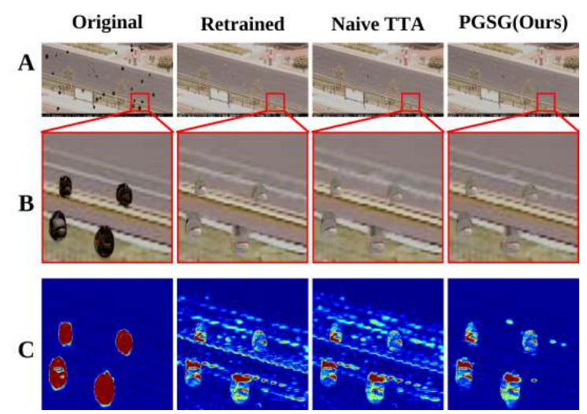

# Physics-Guided Safety Gating (PGSG)

**Physics-Guided Safety Gating: Balancing Structure Preservation and Raindrop Removal**
Kento Ichihara, Lin Meng — Ritsumeikan University
*NCAA 2026 (camera-ready)*

This repository presents the idea behind PGSG and its reference implementation.
It contains the gating algorithm, the evaluation protocol used for Table 1 and
the significance test. The simulated dataset and the retrained checkpoints are
**not** distributed (see [Scope](#scope)).


*Fig. 4 of the paper (HINet). (A) full images, (B) raindrop patches, (C) error maps vs. ground truth.
PGSG removes the drops like the retrained model, but its residual errors stay confined to the drop regions.*

---

## Motivation

Fine-tuning a deraining network on domain-specific raindrop data raises PSNR,
but it also **over-corrects**: high-frequency background textures such as foliage
or lane markings are mistaken for rain and smoothed away, which lowers SSIM in
regions that had no rain. The pre-trained ("original") model has the opposite
profile: it preserves structure, but it leaves wide-angle raindrops in place.

Averaging the two, or using test-time augmentation alone, does not resolve this
(see *Retrained + TTA* in the table below). PGSG decides **for each pixel** which
model to trust.

## Method

Given an input $x$, two models with the same architecture are run:

| | Role |
|---|---|
| $f_\text{origin}$ | pre-trained on generic deraining data; *safe*, preserves structure |
| $f_\text{retrain}$ | fine-tuned on raindrop data; removes drops but over-smooths |

**Compound risk.** Three pixel-wise signals are combined:

1. **Epistemic uncertainty**: variance of $f_\text{retrain}$ over $K=3$ TTA views (identity, h-flip, v-flip)
   $$\sigma^2(x) = \tfrac{1}{K}\textstyle\sum_k \big(f_\text{retrain}(T_k x) - \mu(x)\big)^2$$
2. **Reconstruction residual**: where the retrained model actually changes the image
   $$D_\text{res}(x) = |\mu(x) - f_\text{origin}(x)|$$
3. **Structure-aware suppression**: a veto on strong edges of the safe output
   $$W_\text{struct}(x) = \exp\big(-\lambda\,\|\nabla f_\text{origin}(x)\|_1\big)$$

$$R(x) = \mathrm{Norm}\big((\sigma^2 + D_\text{res})\cdot W_\text{struct}\big)$$

Risk is high only where the model is **both** unstable and actively restoring
(a raindrop), **and** the background is smooth. On textured regions,
$W_\text{struct}\approx 0$ vetoes the switch.

**Soft gating.**

$$\alpha(x) = \mathrm{Sigmoid}\big(\gamma\,(R(x)-\tau)/\tau\big), \qquad
\hat y = \alpha \odot \mu + (1-\alpha)\odot f_\text{origin}$$

The restored branch is the TTA mean $\mu$, the same quantity the residual
$D_\text{res}$ was measured on. The gate therefore admits exactly the
prediction it assessed, and that prediction also has lower variance.

PGSG needs no extra training and no change to either network. Any pair of
checkpoints with the same output space can be gated.

## Code map

| Paper | Code |
|---|---|
| Eq. (5) TTA variance | [`pgsg/inference.py`](pgsg/inference.py) `predict_tta`, [`pgsg/gating.py`](pgsg/gating.py) `estimate_risk` (a) |
| Eq. (6) residual | `estimate_risk` (b) |
| Eq. (7) structure suppression | `structure_intensity`, `estimate_risk` (c) |
| Eq. (8) compound risk | `estimate_risk` |
| Eq. (9)–(10) gate & fusion | `PhysicsGuidedSafetyGater.apply` |
| Per-architecture $\tau,\gamma,\lambda$ | [`pgsg/configs.py`](pgsg/configs.py) |
| Table 1 protocol | [`scripts/evaluate.py`](scripts/evaluate.py) |
| Wilcoxon signed-rank test | [`scripts/significance.py`](scripts/significance.py) |

### Implementation notes

The code follows Eq. (5)–(10) of the paper, with these clarifications:

- **Gradient (Eq. 7)**: Sobel, $|G_x|+|G_y|$ averaged over RGB and divided by 8 so that a unit-slope ramp has magnitude 1.
- **Normalization (Eq. 8)**: min–max over $\sigma^2 + D_\text{res}$ *before* the structural veto. $W_\text{struct}$ then acts as a pure multiplicative veto, and $\tau$ is measured against the normalized evidence. As a result, a single $\tau$ works for all five architectures.
- **Threshold (Eq. 9)**: the sigmoid argument $\gamma(R-\tau)/\tau$ is a re-parameterization of $\gamma'(R-\tau)$ with $\gamma'=\gamma/\tau$.
- **Fusion (Eq. 10)**: the TTA mean $\mu$, as explained above. Eq. (10) of the paper writes $f_\text{retrain}(x)$.
- **Smoothing**: $R$ is smoothed with a Gaussian ($\sigma=1$) and $\alpha$ with a Gaussian ($\sigma=3$) to avoid seams. Unlike a morphological dilation of $\alpha$, Gaussian smoothing does not re-open the gate over edges next to a drop, so the veto of Eq. (7) is respected.

The script that produced Table 1 differed from the paper's equations: forward
differences instead of Sobel, max-normalization after the veto, and an extra
11×11 dilation of $\alpha$. The choices above were settled by an ablation
([below](#ablation-paper-vs-implementation-choices)).

## Results

### Paper (Table 1)

PSNR [dB] / SSIM on the physics-based wide-angle raindrop test set (N = 195; lens curvature R = 12, 30, 100 mm).
*** marks p < 0.001 (Wilcoxon signed-rank test vs. Retrained + TTA, for both PSNR and SSIM).
These numbers come from the original evaluation script, not from the cleaned-up gating in this repository (see notes).

| Model | Original SSIM | Retrained | Retrained + TTA | **PGSG** | |
|---|---|---|---|---|---|
| NAFNet    | 0.958 | 28.94 / 0.936 | 29.32 / 0.944 | **30.07 / 0.961** | *** |
| PReNet    | 0.964 | 27.47 / 0.928 | 28.17 / 0.938 | **28.66 / 0.960** | *** |
| Restormer | 0.969 | 29.63 / 0.933 | 30.32 / 0.941 | **30.62 / 0.947** | *** |
| MPRNet¹   | 0.960 | 28.62 / 0.923 | 29.40 / 0.938 | **30.33 / 0.962** | *** |
| HINet     | 0.969 | 28.98 / 0.912 | 29.66 / 0.922 | **31.37 / 0.955** | *** |

¹ The paper's MPRNet numbers (both Original and Retrained) were computed from
MPRNet's **stage-1** output, because the evaluation script took the last element
of MPRNet's output list `[stage3, stage2, stage1]`. This repository uses the
final stage-3 output. On 15 test images (5 per curvature), with the gating used
for Table 1 and otherwise unchanged settings, switching to stage 3 raises every
column (stage 1 → stage 3):

| | Original | Retrained | Retrained + TTA | PGSG |
|---|---|---|---|---|
| PSNR | 26.61 → 27.06 | 26.77 → 28.53 | 27.25 → 29.23 | 28.02 → 30.74 |
| SSIM | 0.940 → 0.960 | 0.913 → 0.924 | 0.923 → 0.933 | 0.936 → 0.960 |

PGSG still outperforms Retrained + TTA, so the paper's conclusion is unchanged.
With the original script's gating, this code reproduces the paper's per-image
values for NAFNet, HINet, PReNet and MPRNet (stage 1) to within 0.001 dB in
fp32. For Restormer, run on a 12 GB GPU with `--precision fp16` (see
[Hardware](#hardware)), the Original, Retrained and Retrained + TTA outputs match
the paper's values to within 0.05 dB / 0.001 SSIM.

### Ablation: paper vs. implementation choices

30 test images (10 per lens curvature), five architectures. Each variant changes
one item relative to the original script, and $\tau$ is swept over
{0.005, …, 0.3}. Two summaries are shown: the single $\tau$ shared by all five
architectures that maximizes mean PSNR, and the PSNR-optimal $\tau$ chosen per
architecture.
*Clean SSIM* is SSIM restricted to pixels away from raindrops (|input − GT| ≤ 10, dilated by 15 px).
Rows are means over the five architectures; Retrained + TTA reaches 26.31 dB / 0.920 SSIM / 0.932 clean SSIM.

| Variant | shared τ | PSNR | SSIM | clean SSIM | per-arch τ: PSNR | SSIM | clean SSIM |
|---|---|---|---|---|---|---|---|
| Original script (diff, max-norm after veto, dilate + blur, μ) | 0.20 | 27.06 | 0.950 | 0.971 | 27.33 | 0.953 | 0.974 |
| + Sobel | 0.30 | 27.32 | 0.955 | 0.977 | 27.52 | 0.955 | 0.975 |
| + Eq. 8 normalization | 0.20 | 27.08 | 0.952 | 0.973 | 27.43 | 0.956 | 0.977 |
| + blur only (no dilation) | 0.10 | 27.85 | 0.954 | 0.979 | 28.42 | 0.958 | 0.983 |
| + no smoothing | 0.30 | 26.60 | 0.955 | 0.982 | 27.07 | 0.947 | 0.973 |
| + single prediction in Eq. 10 | 0.30 | 26.78 | 0.953 | 0.977 | 26.95 | 0.953 | 0.974 |
| Paper, literal (Sobel, Eq. 8, no smoothing, $f_\text{retrain}$) | 0.30 | 26.77 | 0.957 | 0.984 | 27.10 | 0.950 | 0.976 |
| **This repository** (Sobel, Eq. 8, blur only, μ) | **0.10** | **28.22** | 0.955 | 0.980 | **28.80** | **0.961** | **0.985** |

The PSNR-vs-$\tau$ curve of this repository's gating is flat between 0.07
(28.21 dB) and 0.10 (28.22 dB); larger $\tau$ trades PSNR for SSIM (0.3: 27.70 dB / 0.962).
With the shared default $\tau=0.10$ (N = 30, Wilcoxon vs. Retrained + TTA):

| Model | Retrained + TTA | PGSG (this repo) | Original | p (PSNR) | p (SSIM) |
|---|---|---|---|---|---|
| HINet     | 25.15 / 0.885 | 27.77 / 0.951 | 28.04 / 0.968 | 1.9e-9 | 1.9e-9 |
| MPRNet    | 28.03 / 0.932 | 31.39 / 0.965 | 27.84 / 0.963 | 1.9e-9 | 1.9e-9 |
| NAFNet    | 27.81 / 0.947 | 28.64 / 0.963 | 27.62 / 0.964 | 0.020  | 1.9e-9 |
| PReNet    | 27.33 / 0.934 | 27.70 / 0.957 | 24.29 / 0.961 | 8.0e-6 | 1.9e-9 |
| Restormer | 23.26 / 0.903 | 25.61 / 0.940 | 27.92 / 0.969 | 1.9e-9 | 1.9e-9 |

PGSG improves on Retrained + TTA for every architecture. The SSIM gains are
significant at p < 0.001 for all five, and the PSNR gains for all except NAFNet
(p = 0.02).

$\tau$ was selected on these same 30 images, just as the paper's thresholds
were chosen by sensitivity analysis on the test set. The numbers therefore show
how the design choices compare, not held-out performance. Restormer was run with
`--precision fp16`, and the other models in fp32.

## Setup

```bash
git clone --recursive https://github.com/ri0135sx/Physics-Guided-Diagnostics.git
cd Physics-Guided-Diagnostics
pip install -r requirements.txt
```

The five architectures are loaded from their official repositories, pinned as
submodules in `third_party/`. Run `git submodule update --init` if you cloned
without `--recursive`.

### Hardware

The paper's experiments ran on an RTX 4090 (24 GB) in fp32, the default here.
At 1080p, full-image Restormer inference needs more than 12 GB in fp32. On
12 GB GPUs (e.g. RTX 3080 Ti), pass `--precision fp16` to `evaluate.py` or
`run_pgsg.py`: inference stays full-image under fp16 autocast (about 9.4 GB
peak for Restormer), and results stay within 0.05 dB of fp32.

| GPU memory | Option |
|---|---|
| 24 GB (paper: RTX 4090) | default (`--precision fp32`) |
| 12 GB | `--precision fp16` |

If even that runs out of memory, the code falls back to 512-px tiles and warns.
Tiling changes the output of Restormer, whose attention is computed over the
whole image.

### Checkpoints

Place checkpoints in `weights/` under the names listed in [`pgsg/configs.py`](pgsg/configs.py).

- **Original** models: the public checkpoints of each official repository
  (HINet Rain13k, MPRNet deraining, Restormer deraining, PReNet6 Rain100H,
  NAFNet GoPro width-32).
- **Retrained** models: fine-tune each architecture on
  RainDropClarity (Wang et al., *Raindrop Clarity: A Dual-Focused Dataset for
  Day and Night Raindrop Removal*, CVPR 2024) with its official training code. These checkpoints are not distributed.

## Usage

Gate a single image:

```bash
python scripts/run_pgsg.py --arch HINet \
    --origin weights/HINet-Rain13k.pth --retrained weights/HINet.pth \
    --input rainy.png --out_dir outputs/
# -> outputs/rainy_pgsg.png, rainy_alpha.png (gate), rainy_risk.png (compound risk)
```

Benchmark all architectures on paired data (`Input_*.png` / `Target_*.png`):

```bash
python scripts/evaluate.py --data_dir <test_dir> --weights_dir weights --out_dir results
# on a 12 GB GPU: add --precision fp16
python scripts/significance.py results/per_image_metrics.csv
```

Use as a library:

```python
from pgsg import PhysicsGuidedSafetyGater, GATING_CONFIGS, load_model, predict, predict_tta

gater = PhysicsGuidedSafetyGater(**GATING_CONFIGS["HINet"])
y_origin = predict(m_origin, x)                # x: (1, 3, H, W) in [0, 1]
y, alpha, risk = gater(predict_tta(m_retrain, x), y_origin)
```

## Scope

- **Dataset.** The test set was rendered with our physics-based simulator:
  droplet shapes from the augmented Young–Laplace equation on a spherical lens,
  backward spectral ray tracing with Snell's law and Cauchy dispersion, and
  CDNet backgrounds. Neither the rendered data nor the simulator is part of
  this release; see Sec. 3.1 of the paper for the model.
- **Weights.** The retrained checkpoints are not released.

## Citation

```bibtex
@inproceedings{ichihara2026pgsg,
  title     = {Physics-Guided Safety Gating: Balancing Structure Preservation and Raindrop Removal},
  author    = {Ichihara, Kento and Meng, Lin},
  booktitle = {Neural Computing for Advanced Applications (NCAA)},
  year      = {2026}
}
```

## License

The code in this repository is released under the [MIT License](LICENSE).
Third-party architectures in `third_party/` keep their own licenses
(HINet, NAFNet, Restormer: MIT; MPRNet: Academic Public License; PReNet: see its repository).

## Acknowledgements

This work builds on [HINet](https://github.com/megvii-model/HINet),
[MPRNet](https://github.com/swz30/MPRNet),
[NAFNet](https://github.com/megvii-research/NAFNet),
[PReNet](https://github.com/csdwren/PReNet) and
[Restormer](https://github.com/swz30/Restormer).
